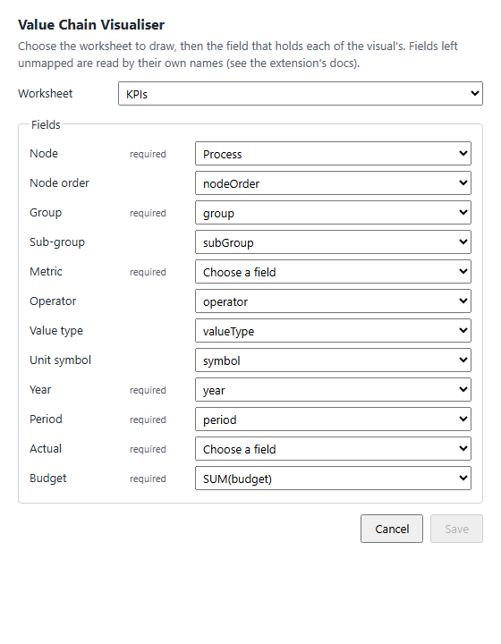

# Value Chain Visualiser for Tableau

The Value Chain Visualiser as a Tableau dashboard extension. It is thin glue
around `@appswyldesolutions/vcv-web-component`: it reads a worksheet's data
through Tableau's Extensions API and sets it as the `rows` of a
`<value-chain-visualiser>` element, which does all the drawing. The element
opens with compact cards.

This package is private: it ships as a hosted page plus a `.trex` manifest,
not to npm. The page is hosted on GitHub Pages at
https://appswyldesolutions.github.io/value-chain-visualiser/tableau/.

## Add it to your dashboard

1. Download the manifest,
   [value-chain-visualiser.trex](https://appswyldesolutions.github.io/value-chain-visualiser/tableau/value-chain-visualiser.trex),
   and keep it somewhere stable: Tableau remembers where it was opened from.
2. Make a worksheet with one mark per KPI per period, as
   [docs/tableau-data-shaping.md](../../docs/tableau-data-shaping.md)
   describes. Its fields can have any names: you map them in step 4.
3. On a dashboard with that worksheet, drag **Extension** from **Objects**
   onto it, choose **Access Local Extensions**, and open the `.trex`.
   Tableau asks whether to allow the extension, which runs from the
   GitHub Pages address above; choose **OK**.
4. If the worksheet's fields are not named after the visual's (`node`,
   `group`, `metric`, `year`, `period`, `actual`, `budget`, …), the
   **Configure** dialog opens: choose the worksheet, and the field that
   holds each of the visual's, then **Save**. To change it later, use
   **Configure…** in the extension zone's menu.
5. The visual draws the worksheet, and redraws as its filters change. If a
   required field is missing it says which.

## Configure



**Configure…** in the zone's menu (the manifest's
`<configure-context-menu-item/>`) opens `config.html` in a Tableau dialog
(`tableau.extensions.ui.displayDialogAsync`):

- **Worksheet:** any worksheet on the dashboard.
- **Fields:** a column of that worksheet for each of the visual's fields,
  by its summary-data name (`Process`, `SUM(Sales Actual)`). Each starts
  from the saved mapping, or else the column with the field's own name.
  **Save** stays disabled until every required field has one.
- **Save** writes the mapping to the extension's settings
  (`tableau.extensions.settings`, key `vcv.mapping`:
  `{ "version": 1, "worksheet": …, "fields": { "node": "Process", … } }`),
  which Tableau keeps in the workbook. The visual redraws with it straight
  away, and reads it again whenever the workbook opens.

Without a saved mapping the extension works as before: it draws the
dashboard's first worksheet, reading each field by its own name. A field
left unmapped is read the same way. The dialog opens by itself only for
an author (not a viewer) who adds the extension to a worksheet without
those names; after that, only from the menu.

If a mapped worksheet or field is gone (renamed, or removed from the
dashboard), the extension says which, for example
`"KPIs" has no field for metric (mapped to "KPI Name"). Use Configure… to map it.`

To use it on Tableau Server or Tableau Cloud, a site administrator allows
it first: in the site's extension settings, let extensions run, then add
`https://appswyldesolutions.github.io` to the allowed list (or allow
unknown extensions). Signing the extension and listing it on Tableau
Exchange are not done yet.

## How it works

- `index.html` loads Tableau's `lib/tableau.extensions.1.latest.js` with a
  plain script tag, as Tableau intends. The library (v1.17.0, Apache-2.0,
  from [tableau/extensions-api](https://github.com/tableau/extensions-api/tree/main/lib))
  is vendored in `public/lib/` and served from the extension's own origin,
  so the extension makes no requests elsewhere. It is not an npm dependency;
  `src/tableau.ts` types the part of it the extension uses.
- `src/extension.ts` calls `tableau.extensions.initializeAsync()`, reads the
  dashboard's first worksheet with `getSummaryDataAsync()`, and sets the
  element's `rows`. It listens for the worksheet's `SummaryDataChanged`
  (filters, parameters, data edits; `FilterChanged` on Tableau versions
  before API 1.9) and reads the data again, redrawing the element in place.
- Problems (no worksheet, missing fields, no marks, Tableau errors) show as
  a line of text in place of the visual.

## Data

The worksheet must have **one mark per KPI per period**, with a field named
after each `KpiRow` field: the Power BI visual's shaped table, field for
field. `src/rows.ts`'s `rowsFromSummaryData` reads each field from the
summary-data column of that name, so column order does not matter and other
fields are ignored.

| Field       | Required | Read as                                         |
| ----------- | -------- | ----------------------------------------------- |
| `node`      | yes      | the card (process / link) the KPI sits on       |
| `nodeOrder` | no       | the card's position; left out, 0 for every card |
| `group`     | yes      | `Primary`, `Satellite` or `Transfer Points`     |
| `subGroup`  | no       | blank if left out                               |
| `metric`    | yes      | the KPI's name                                  |
| `operator`  | no       | `LessThan`, or `Equal` for anything else        |
| `valueType` | no       | `Number` if left out                            |
| `symbol`    | no       | the unit symbol; blank if left out              |
| `year`      | yes      | a number                                        |
| `period`    | yes      | the month, as shown (`January`)                 |
| `actual`    | yes      | a number; blank is no data                      |
| `budget`    | yes      | a number; blank is no data                      |

- **Names are exact**, case and all. A name wrapped in the aggregation
  Tableau gives it also matches: `SUM(actual)`, `ATTR(node)`.
- **Until every required field is there** the extension draws nothing and
  says which to add: `"KPIs" needs fields named metric and budget.`
- Numbers may be text, with thousands separators (`"604,000"`).

[docs/tableau-data-shaping.md](../../docs/tableau-data-shaping.md) shows how
to build such a worksheet, from the shaped table or from the API's
month-per-column records.

## Develop in Tableau Desktop

1. From the repo root, serve the extension:

   ```sh
   npm start -w packages/tableau-extension
   ```

   Vite serves it at http://localhost:8765, with core, the renderer and the
   web component straight from source, so edits show on reload with no
   build. Tableau allows plain http only for localhost.

2. In Tableau Desktop, connect to
   [`samples/powerbi/shaped-table.tsv`](../../samples/powerbi/shaped-table.tsv)
   (the fixture, already shaped) and build the worksheet as
   [docs/tableau-data-shaping.md](../../docs/tableau-data-shaping.md#from-the-shaped-table)
   describes.
3. Make a dashboard, add the worksheet, then drag **Extension** from Objects
   onto it, choose **Access Local Extensions** and open
   `value-chain-visualiser.dev.trex` from this folder (the dev server
   writes it when it starts).
4. Change a filter on the worksheet: the visual redraws. To reload the page
   after a code change, use the extension zone's menu → **Reload**.

If the extension shows a blank zone, enable remote debugging (see Tableau's
[Debug extensions in Tableau Desktop](https://tableau.github.io/extensions-api/docs/debug/trex_debugging))
and open the page's console in Chromium.

## Build

`npm run build -w packages/tableau-extension` (part of the root
`npm run build` and `npm run verify`, after the web component) writes the
static site to `dist/`, ready to host, with its manifest beside it:

```sh
TABLEAU_EXTENSION_URL=https://example.com/vcv/index.html npm run build -w packages/tableau-extension
```

- `dist/value-chain-visualiser.trex` points at `TABLEAU_EXTENSION_URL`.
  Without it, it points at the GitHub Pages page (`HOSTED_URL` in
  `src/manifest.ts`). The build fails for a URL that is not https:
  Tableau loads plain http only from localhost.
- The build bundles the web component's built `dist/`, not its source.
- `npm run preview -w packages/tableau-extension` serves `dist/` from the
  path GitHub Pages serves it from, at
  http://localhost:4174/value-chain-visualiser/tableau/.

## Deploy

`.github/workflows/pages.yml` deploys the extension to GitHub Pages after
every push to `main` that the `verify` workflow passes (and by hand, from the
Actions tab). It builds core, the renderer, the web component and the
extension for the Pages URL, then publishes `dist/` under `tableau/`. It
never deploys a pull request's code. Pages is set to deploy from GitHub
Actions (**Settings → Pages → Source**).

## Manifest

`src/manifest.ts` writes both `.trex` files, through the Vite plugin in
`src/trexPlugin.ts`: the hosted one at build, and
`value-chain-visualiser.dev.trex` (git-ignored, for
http://localhost:8765) when the dev server starts.

- **id** `com.wyldesolutions.valuechainvisualiser`, reverse-domain as
  Tableau requires; the development one adds `.dev`, so both can be
  installed side by side.
- **extension-version** is this package's version. The package is private
  and never published to npm, but changesets version it like the others
  (`.changeset/config.json` `privatePackages`), so a release's changeset
  bumps the manifest too.
- **min-api-version** 1.4. Where the extension uses newer API, it falls
  back: without `SummaryDataChanged` (1.9) it listens for `FilterChanged`.
- **No permissions.** Tableau's only one, full data, is for the
  underlying-data APIs; `getSummaryDataAsync` needs none.
- **icon** `assets/icon.png`, the 70x70 PNG Tableau requires, rendered from
  `assets/icon.svg` by `npm run icon -w packages/tableau-extension`.

## Test

- Unit tests (`src/*.test.ts`, run by the root `npm test`) drive
  `startExtension` against a fake `window.tableau`.
- `npx playwright test --project=tableau-extension` (part of `npm run e2e`)
  loads the page from the dev server with Tableau's library swapped for a
  fake dashboard, and checks the real library loads and only starts inside
  Tableau.
- `npx playwright test --project=tableau-hosted` (also part of
  `npm run e2e`) does the same against the built `dist/`, served from its
  Pages path, and checks the `.trex` it serves points at GitHub Pages. It
  needs `npm run build` first.
- `test/pages-workflow.test.ts` checks the deploy workflow: when it runs,
  what it builds, and that it builds for `HOSTED_URL`.
